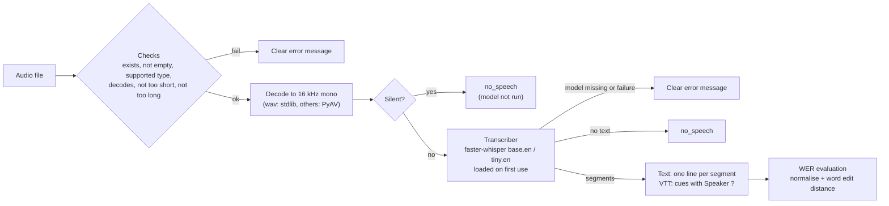

# ASR Transcriber (local Whisper, text + WebVTT, measured WER)

Transcribes an audio file (wav, mp3, flac, ogg, m4a) to plain text and to WebVTT with timestamps, using a **local**
[faster-whisper](https://github.com/SYSTRAN/faster-whisper) model. No API key, no LLM, no network after the model is downloaded.
It refuses bad input with a clear message instead of crashing, and it includes a word-error-rate (WER) evaluation written from scratch.

## Data and models: what is public and what is synthetic
- **Synthetic (generated by code, nothing committed):** the tests and the `--mock` evaluation use silence, tones, noise and tiny wav/mp3
  files created in `src/asr_transcriber/synthetic.py`, plus invented sentences. No real recording is in this repo.
- **Public clips (not in this repo):** the first 10 clips of **LibriSpeech `test-clean`** with their reference transcripts, fetched by
  `scripts/download_clips.py` into `data/clips/` (git-ignored). The archive is **streamed and reading stops as soon as 10 clips are found**, so
  only the start of the 346 MB archive is read. The 10 clips are about 1.5 MB on disk and the download took about 16 s; the number of bytes streamed was not measured. The clips are the first 10 with transcripts in archive order, so their numbers are not consecutive.
  - **Source:** <https://www.openslr.org/12/>. **Licence:** CC BY 4.0.
  - **Credit:** V. Panayotov, G. Chen, D. Povey, S. Khudanpur, *LibriSpeech: an ASR corpus based on public domain audio books*, ICASSP 2015.
  - LibriSpeech is clean, read audiobook speech. It says little about meetings, noise or accents.
- **Model (not in this repo):** faster-whisper converted Whisper weights, `Systran/faster-whisper-base.en` (default) or `tiny.en`, both listed on
  Hugging Face as **MIT**; faster-whisper itself is MIT. Downloaded to the Hugging Face cache on first use (roughly 75 MB for `tiny.en`, 145 MB for `base.en`).

## Architecture


## Tech
Python 3.11, faster-whisper (CTranslate2, CPU int8), PyAV (audio decoding, installed with faster-whisper), NumPy, pytest, Docker.

## How to run
```powershell
python -m venv .venv
.venv\Scripts\pip install -r requirements.txt       # faster-whisper pulls in CTranslate2, PyAV, ONNX Runtime ...
$env:PYTHONPATH = "src"
python -m asr_transcriber path\to\talk.wav           # writes output\talk.txt and output\talk.vtt
python -m asr_transcriber talk.mp3 --model tiny.en --out-dir out --print
python -m asr_transcriber talk.wav --no-speaker      # VTT cues without the "Speaker ?" label
```
The first real run downloads the model from Hugging Face (needs internet). Afterwards it works offline. `ASR_MODEL_DIR` chooses the model folder and
`ASR_OFFLINE=1` forbids any download (a missing model then gives a clear message). All settings are optional environment variables; see `.env.example`.

| Setting | Default | Meaning |
|---|---|---|
| `ASR_MODEL` / `--model` | `base.en` | model name; `tiny.en` is faster and less accurate |
| `ASR_MODEL_DIR` | Hugging Face cache | where model files are stored |
| `ASR_OFFLINE` | off | never download |
| `ASR_LANGUAGE` | `en` for `*.en` models, otherwise auto | language hint |
| `MAX_AUDIO_MINUTES` | 30 | longer audio is refused with a message |
| `SILENCE_DBFS` | -50 | audio quieter than this (RMS) is reported as silence |

Exit code: 0 transcribed; 1 no speech or an error (message on stderr, nothing written); 2 command-line usage error.

### Tests (no model, no network, no downloads)
```powershell
python -m pytest -q -rs
```
Tests use a fake transcriber, a fake `faster_whisper` module for the wrapper, and synthetic audio generated by code. One optional live test is
skipped unless faster-whisper is installed, `tiny.en` is already cached **and** the clips were downloaded; it never downloads anything.

### Evaluation (WER)
```powershell
python -m asr_transcriber.evaluate --mock                 # plumbing check: synthetic tones + a scripted fake model
python scripts\download_clips.py                          # once: 10 LibriSpeech clips into data\clips
python -m asr_transcriber.evaluate --live --out docs\eval_live.json            # base.en
python -m asr_transcriber.evaluate --live --model tiny.en --out docs\eval_tiny.json
```
`--mock` prints "NOT accuracy" and reports no timing; its numbers must never be quoted as results.
**Normalisation** (applied to both reference and model output, so only word differences count): lowercase; curly apostrophes made straight;
hyphens, dashes and underscores become spaces; all other punctuation removed; apostrophes at the edges of a word removed (inside a word they stay);
whitespace collapsed. **Not normalised:** numbers vs spelled-out numbers, British vs American spelling, contractions vs full forms, filler words,
so scores are stricter than, and not directly comparable with, published Whisper numbers. WER = (substitutions + deletions + insertions) / reference words,
from a word-level edit distance (`src/asr_transcriber/wer.py`, tested against hand-checked cases). **Corpus WER pools all errors over all reference words**
(it is not the mean of per-clip rates; both are reported). A clip that fails or returns no text counts as all of its reference words missed, so failures
lower the score instead of disappearing. The real-time factor (transcription time / audio length) is reported for `--live` only; the model is loaded (and on the first run downloaded) before the clock starts, and that time is reported separately as `model_load_seconds`.

## Output formats
- **Text:** one line per segment.
- **WebVTT:** `WEBVTT`, a blank line, then numbered cues `HH:MM:SS.mmm --> HH:MM:SS.mmm` followed by one line of text. Hours are always present, times are never
  negative, every cue ends after it starts, text is one line with `& < >` escaped and `-->` removed. Tests check this with a strict reader written from the format rules.
- **Speakers:** Whisper does not identify speakers, so none are invented. By default each cue is `<v Speaker ?>text</v>`.

### Reading the VTT with my meeting-summarizer project
I parsed this tool's VTT with the meeting-summarizer parser once by hand (read-only, not an automated test). What it showed:
- **Default (`Speaker ?`):** the parser reads every cue as speaker `Speaker ?`, escapes round-trip correctly, **but it merges consecutive cues of the same speaker, so a whole recording becomes one long turn** with the timestamp of its first cue. The summariser can still process it (a long turn is split into chunks), but action items would only carry that first timestamp.
- **`--no-speaker`:** every cue stays its own turn with its own timestamp, **but** a cue whose text starts like `Name: text` (for example someone saying "Sam said: ...") is read by that parser's plain-text rule as a speaker called "Sam said". The default avoids this because the voice tag overrides the rule.
Choose per use: default for safety against false speaker names, `--no-speaker` when per-cue timestamps matter more.

## Design choices
- **Checks before the model.** The file is validated and decoded first; the model is loaded only on the first transcription, so bad files never trigger a model download.
- **Every failure is a message, never a traceback:** file not found, a directory, empty file, corrupt audio, unsupported format (the supported ones are listed), too short, too long (the limit is named), silence, no text from the model, model not installed, model missing or download failed (with a hint about `ASR_MODEL_DIR` / `ASR_OFFLINE`), unexpected model errors, unwritable output folder, bad environment values.
- **Silence is detected in code** (RMS level) so the model is not run on digital silence, which avoids made-up text; anything audible, such as a tone or noise, still goes to the model, which may return no text.
- **VAD filter on** for the real model (faster-whisper's Silero VAD) to skip long non-speech stretches.
- **WER is written in code and tested** instead of using a library, so the metric is fully visible.
- **No speaker names are claimed.**
- **A long recording is refused, not truncated** (default 30 minutes).

## Results
**Live run:** the first 10 LibriSpeech `test-clean` clips in the order they appear in the archive (all from speaker 6930, chapter 75918; 206 reference
words and 77.8 s of audio in total), run with `python -m asr_transcriber.evaluate --live`. faster-whisper 1.2.1 / CTranslate2 4.8.3, **CPU only, int8**, on an
**11th Gen Intel Core i5-1135G7 @ 2.40 GHz (4 cores / 8 threads), 23.7 GB RAM, Windows 11**. Raw output: `docs/eval_base_en.json`, `docs/eval_tiny_en.json`.

**These numbers describe clean, read audiobook speech on these 10 clips only.** LibriSpeech is the easy case for speech recognition: no background noise,
one steady speaker, careful reading. Do not expect the same error rate on meetings, phone audio, accents, overlapping speakers or technical vocabulary.

| Measure | `base.en` (default) | `tiny.en` |
|---|---|---|
| Corpus WER (errors / 206 reference words) | **0.0291** (6 errors) | **0.0243** (5 errors) |
| Mean per-clip WER | 0.0323 | 0.0366 |
| Substitutions / deletions / insertions | 6 / 0 / 0 | 5 / 0 / 0 |
| Clips that failed or returned no text | 0 of 10 | 0 of 10 |
| Real-time factor on this CPU (transcription time / audio time, model loading excluded) | 0.099 (about 10x faster than real time) | 0.063 (about 16x faster than real time) |
| Model load time | 1.3 s (model already on disk) | 15.7 s (includes the one-time download) |

**How to read it.**
- The two models are **not meaningfully different on accuracy here**: `tiny.en` made one error fewer than `base.en` (5 vs 6 of 206 words). With 10 clips from one chapter that gap is noise; it does not show that the smaller model is more accurate.
- Every error is a single-word substitution; there were no deletions, insertions or failed clips. The errors, from the saved per-clip details (reference -> model output): `concord -> concorde` (both models; a proper noun), `before -> for` (both), `country's -> country` and `master's -> masters` (both; possessive apostrophes), `love -> loved` and `had -> has` (`base.en` only), `were -> we're` (`tiny.en` only; the strict normalisation counts a contraction as an error).
- Speed is for this laptop CPU and these short clips (3-23 s). It is a measurement of one machine, not a promise.
- An earlier run counted the one-time model download inside the first clip's time (28.8 s for a 3.5 s clip) and printed a wrong real-time factor of 0.454. The code was fixed so the model is loaded before the clock starts and the load time is reported separately; the numbers above are from the fixed code.
- The WER here is the strict one described above (numbers, spelling and contractions are not normalised), so it is not directly comparable with published Whisper results.

## Real output check
The CLI was run once on a real clip (`base.en`, 23.3 s of audio, 5 segments, 0.06x real time): the text and WebVTT files were written, and the VTT is in the format above
(`<v Speaker ?>` cues with `HH:MM:SS.mmm` times). My meeting-summarizer parser reads it without warnings and, as described above, merges the cues into one turn
with the first cue's timestamp. This was checked by hand once; it is not an automated test.

## Limitations
- **CPU speed:** transcription runs on CPU (int8). On the laptop CPU named under Results it ran about 10x (`base.en`) and 16x (`tiny.en`) faster than real time on short clips; that is one machine, and a slower CPU or a long recording will take longer. Only 10 short clips (3-23 s) were timed.
- **No speaker labels:** Whisper gives text and timestamps only. There is no diarisation here.
- **Accents, noise and domain words:** accuracy is likely to be worse than on LibriSpeech for accented, noisy, overlapping or technical speech. LibriSpeech is clean read speech, so its WER is a best case, not a prediction.
- **Whisper can invent text on non-speech** (music, noise). Only silence is caught before the model; the VAD filter helps but is not a guarantee.
- **The evaluation is tiny:** 10 clips from one chapter and one speaker (206 words), so the WER has wide uncertainty and applies to those clips only. A difference of one word, like the one between `tiny.en` and `base.en`, means nothing.
- **The normalisation is strict** (numbers, spelling and contractions count as errors), so numbers are not comparable with published ones.
- **Resampling:** non-16 kHz WAV files use a plain linear resampler; give 16 kHz audio for best results. Other formats are resampled by PyAV.
- **Whole file in memory:** the audio is decoded fully before transcribing (about 64 KB per second of audio as float32, more while decoding; roughly 115 MB for 30 minutes), which is why the 30-minute default limit exists.
- **English models only by default** (`base.en`, `tiny.en`); other models can be named with `--model` but have not been tried.
- The Docker image has not been built or verified yet.

## Next steps
- Evaluate on more clips and speakers (including a noisy or accented set) so the two models can actually be compared.
- Try `int8` vs `float32` and a larger model such as `small.en`, and measure speed and accuracy again.
- Optional speaker separation (diarisation) as a separate, clearly labelled step.
- Build and verify the Docker image.
